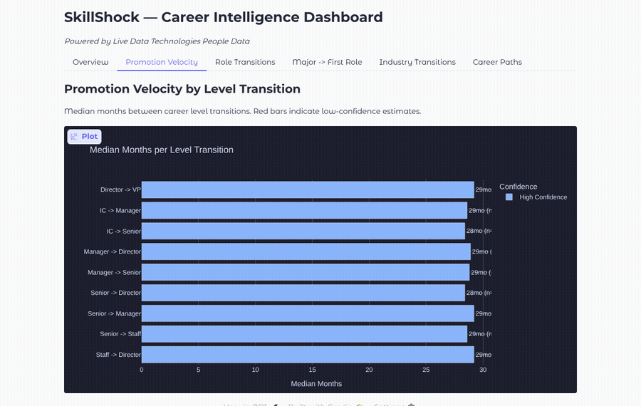
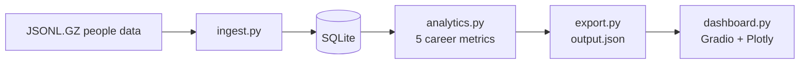

# SkillShock

**What careers actually look like, from 75,000+ real career histories.** SkillShock reconstructs career trajectories from Live Data Technologies people data and turns them into an interactive dashboard: how long promotions take, what jobs a major leads to, and which paths reach a target role.

Built by a team of three at a hackathon (Education & Learning track).



<sub>Shown on synthetic sample data. The real dataset is licensed to the team and isn't in this repo.</sub>

## Questions it answers

- How long does it take to get promoted from IC to Senior? Senior to Director?
- What jobs do Computer Science majors actually get?
- What industries do people switch to from Tech? Finance?
- What career paths lead to VP of Engineering?

## What's interesting

- **Real, messy data at scale.** The pipeline streams 75,139 people and 717,053 job records from compressed JSONL into SQLite, then normalizes messy seniority labels into a consistent career ladder.
- **Five metrics, one export.** `analytics.py` computes promotion velocity (with low-confidence flags for thin samples), role and industry transitions, major-to-first-role and the most common paths to any role, and `export.py` shapes them into a single `output.json`.
- **Tested end to end.** pytest covers ingest, analytics and export against a synthetic fixture.

## Architecture



## Try it on sample data (2 minutes)

```bash
python3 -m venv venv && source venv/bin/activate
pip3 install numpy==2.2.0 && pip3 install -r requirements.txt
python3 make_sample_data.py                     # 3,000 synthetic people into data/
DATA_DIR=data python3 ingest.py && python3 analytics.py && python3 export.py
python3 dashboard.py                            # http://localhost:7860
```

## Setup with the real data

### 1. Create and activate a virtual environment
```bash
python3 -m venv venv
source venv/bin/activate
```

### 2. Install dependencies
```bash
pip3 install numpy==2.2.0
pip3 install -r requirements.txt
```

### 3. Set up environment variables (Optional)
```bash
cp .env.example .env
```
Open `.env` and add your API keys if you have them. The app works without them.

### 4. Add the data files
Download the Live Data Technologies `.jsonl.gz` files from the team Google Drive (link in Discord) and place them in the `data/` folder:
```
SkillShock/
└── data/
    ├── live_data_persons_history_2026-02-19_00.jsonl.gz
    ├── live_data_persons_history_2026-02-19_01.jsonl.gz
    └── live_data_persons_history_2026-02-19_02.jsonl.gz
```

### 5. Run the pipeline
Run these in order — each must finish before the next:
```bash
DATA_DIR=data python3 ingest.py
python3 analytics.py
python3 export.py
```

You should see:
- `ingest.py` → `Ingested 75139 records total`
- `analytics.py` → processes and analyzes the data
- `export.py` → `Wrote ./output.json`

### 6. Launch the dashboard
```bash
python3 dashboard.py
```

Opens at http://localhost:7860 with interactive charts:

- **Promotion Velocity** — median months between career levels
- **Role Transitions** — what title comes next?
- **Major to First Role** — what jobs do graduates actually get?
- **Industry Transitions** — where do people switch industries to?
- **Career Paths** — most common paths to any target role

## Test

```bash
pytest tests/ -v
```

## Files

| File | Role |
|---|---|
| `ingest.py` | Parse JSONL.GZ → SQLite |
| `analytics.py` | Compute 5 career metrics |
| `export.py` | Shape metrics into output.json |
| `push.py` | POST to RapidFire AI (optional) |
| `main.py` | Orchestrate the pipeline |
| `dashboard.py` | Interactive Gradio dashboard |

## Data

Uses Live Data Technologies People Data (75,139 people, 717,053 jobs).
Files are shared privately with the team — do not commit to GitHub.

## Tech Stack

Python, SQLite, pandas, Gradio, Plotly, RapidFire AI
